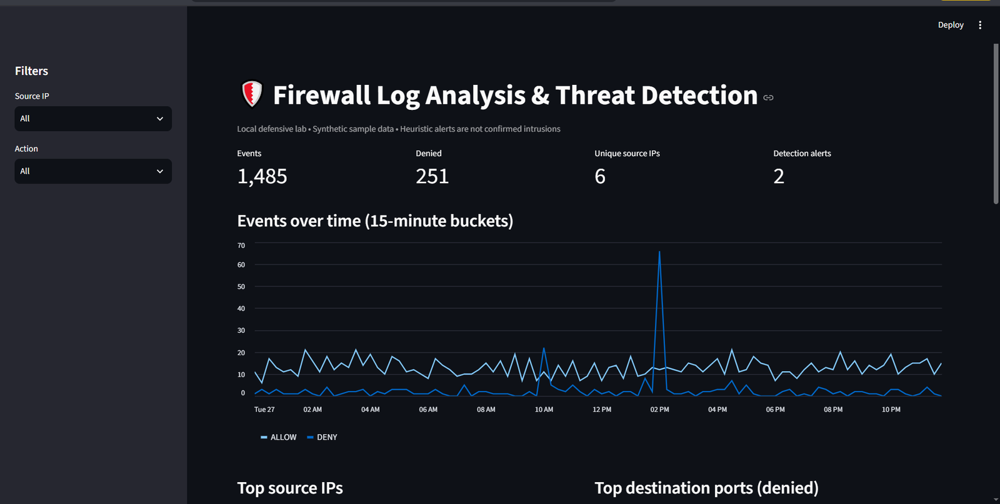
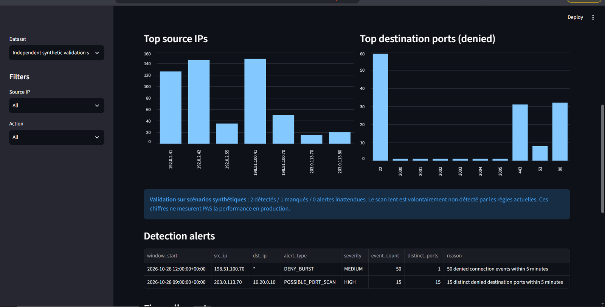

# Firewall Log Analysis & Threat Detection

**A local blue-team portfolio project** — a Python pipeline that parses firewall logs, detects suspicious patterns with explainable rules, stores results in SQLite, and visualizes events and alerts in Streamlit.

**Stack:** Python · Pandas · SQLite · Streamlit · unittest  
**Status:** Working demonstration; evaluated on *synthetic* sample and validation datasets  
**Cost:** Free to run locally; no cloud account or API keys needed

> **Scope and honesty:** All included traffic is **synthetically generated** and uses documentation-only example IP addresses. Alerts are heuristic indicators, **not confirmed intrusions**. This is a personal learning project, **not a deployed production SOC**.

## Dashboard



*Illustrative dashboard running on the provided synthetic sample.*



*Independent synthetic validation scenario and two detected alerts.*

## Architecture

```text
Synthetic firewall event generator / authorized CSV logs
                       |
                       v
           CSV ingestion and schema validation
                       |
                       v
               Pandas normalization
                       |
            +----------+----------+
            |                     |
            v                     v
  5-min window detection    SQLite tables
  - possible port scans     - firewall_logs
  - denied-traffic bursts   - alerts
            |                     |
            +----------+----------+
                       |
                       v
          CSV / JSON reports + Streamlit UI
```

## Detection rules

| Rule | Behavior | Default threshold |
| --- | --- | --- |
| `POSSIBLE_PORT_SCAN` | A source contacts many **distinct denied destination ports on one host** within a fixed UTC time bucket | 12 ports / 5 minutes |
| `DENY_BURST` | A source generates a large number of **denied firewall connections** within a fixed UTC time bucket | 40 denies / 5 minutes |

Thresholds are illustrative. Firewall denies do *not* by themselves show successful exploitation or password guessing.

## Run locally (Windows PowerShell)

Requires **Python 3.10+**.

```powershell
py -m venv .venv
.\.venv\Scripts\python.exe -m pip install -r requirements.txt

# Generate and analyze the demonstration dataset
.\.venv\Scripts\python.exe -m src.generate_sample
.\.venv\Scripts\python.exe -m src.pipeline

# Generate and analyze a second labeled test dataset
.\.venv\Scripts\python.exe -m src.generate_validation
.\.venv\Scripts\python.exe -m src.pipeline --input data/validation_firewall_logs.csv --db outputs/validation/firewall_lab.db --output-dir outputs/validation
.\.venv\Scripts\python.exe -m src.evaluate

# Test and view
.\.venv\Scripts\python.exe -m unittest discover -s tests -v
.\.venv\Scripts\python.exe -m streamlit run dashboard.py
```

Open the local Streamlit URL (usually `http://localhost:8501`). In the dashboard's sidebar, change **Dataset** to *Independent synthetic validation sample* to inspect the validation report.

For macOS/Linux, create/activate a virtual environment with `python3 -m venv .venv` and `source .venv/bin/activate`, then replace the venv executable paths above with `python`.

## Files

```text
firewall-log-threat-detection/
├── dashboard.py                 # Filters, charts, tables, alert view
├── src/
│   ├── detection.py             # Schema checks and rules
│   ├── pipeline.py              # CSV -> Pandas -> SQLite/CSV/JSON
│   ├── generate_sample.py       # Main synthetic dataset generator
│   ├── generate_validation.py   # Independent labeled scenario generator
│   └── evaluate.py              # Scenario-level validation summary
├── tests/test_detection.py      # 6 automated tests
├── data/                       # Synthetic CSVs + labeled ground truth
├── queries.sql                 # Example investigation queries
├── docs/screenshots/           # Screenshots from a local run
├── outputs/                    # Sample reports; DB files not published
└── requirements.txt
```

The `.gitignore` excludes local databases (`*.db`), virtual environments, logs, private `.env` files, and Streamlit secrets.

## Independent synthetic validation

The second generated dataset includes distinct source IPs and labeled behaviors rather than simply reusing the first example.

| Labeled synthetic case | Result |
| --- | --- |
| Fast scan: 15 denied destination ports / 5 min | Detected (`POSSIBLE_PORT_SCAN`) |
| Deny burst: 50 denied events / 5 min | Detected (`DENY_BURST`) |
| Routine activity under configured thresholds | No unexpected alert |
| Slow scan spread over time | **Missed** (false negative) |

**Scenario-level evaluation:** 2 true positives · 0 false positives · 1 false negative (precision 1.0; recall ~0.667 *on these labeled toy cases only*). This is **not** a real-world precision, recall, accuracy, or benchmark claim. A larger, representative labeled dataset would be necessary.

**Technical limitations:**

- Fixed five-minute windows can miss *slow or distributed scans*, especially across bucket boundaries.
- High denied-connection volume can be benign in a busy environment.
- Source IP attribution can be misleading behind NAT/proxies.
- No threat intelligence enrichment, adaptive baselines, or analyst triage workflow is implemented.

**Possible next steps:** rolling-window detection, per-destination baselining, real firewall-format parsers, systematic threshold tuning, and unit-tested additional rules.

## Engineering validation

Run `python -m unittest discover -s tests -v`. The suite contains six tests covering input validation, detection logic, scenario evaluation, report generation, and a **Windows SQLite file-lock regression**. A SQLite handle is explicitly closed after writing so that Windows can remove temporary test DB files.

## Security and data policy

Use only logs from environments that you own or are authorized to assess. Never push real enterprise logs, credentials, access tokens, internal addresses, or personal data to a public repository. The included sample IP ranges are reserved for documentation and are not real source addresses.

## Résumé pour un entretien (français)

> J'ai développé un mini-pipeline de détection à partir de logs de pare-feu avec Pandas et SQLite, et un dashboard Streamlit. Deux règles heuristiques détectent les balayages de ports et les pics de connexions refusées sur des fenêtres de cinq minutes. J'ai validé le fonctionnement sur deux jeux de données synthétiques et documenté une limite importante : les scans lents peuvent échapper aux règles à fenêtre fixe.
